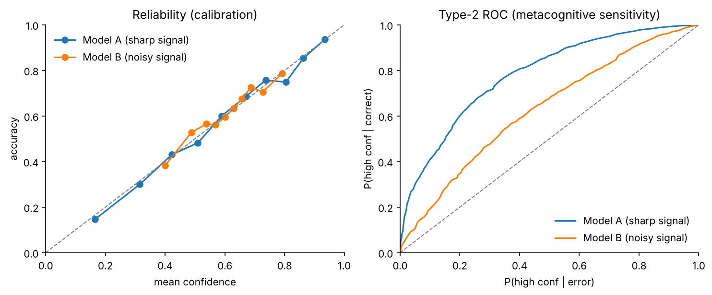

# metad-llm

[](https://github.com/kishoren18-hue/metad-llm/actions/workflows/ci.yml) [](LICENSE)

**Metacognition metrics from cognitive neuroscience, applied to language model confidence.**

Most LLM calibration work reports Expected Calibration Error (ECE) and Brier score. Those tell you whether a model's confidence *matches its accuracy on average*. They do not tell you whether the model's confidence actually *separates its right answers from its wrong ones*, which is the property you need if you want to trust a high-confidence answer or flag a low-confidence one.

Cognitive neuroscience has measured exactly this in humans for over a decade with **meta-d'** (Maniscalco & Lau, 2012), a signal detection theory measure of metacognitive sensitivity, and the **M-ratio** (meta-d' / d'), which asks how much of the information available to the decision also reaches confidence. This package brings those measures to model outputs, with a one-line API and a CLI.



## Why it matters: same ECE, different metacognition

`examples/same_ece_different_metad.py` simulates two models answering 4,000 questions. Both have about 60% accuracy and both are calibrated (ECE = 0.012 each). Model A's confidence comes from a sharp internal signal, model B's from a noisy one.

| | Model A | Model B |
|---|---|---|
| Accuracy | 0.599 | 0.617 |
| ECE | **0.012** | **0.012** |
| Type-2 AUROC | 0.781 | 0.629 |
| meta-d' (95% CI) | 1.79 [1.67, 1.89] | 0.76 [0.65, 0.88] |

ECE says the two models are equally good. meta-d' and the type-2 ROC show that model B barely knows when it is wrong. These numbers come from the simulation in this repo, not from real LLMs; run the script to reproduce them.

## Install

```bash
pip install git+https://github.com/kishoren18-hue/metad-llm
# or, from a clone:
pip install -e ".[dev]"
```

## Quick start

```python
from metad_llm import assess

# one entry per question: was the answer right, and how confident was the model?
correct    = [1, 0, 1, 1, 0, 1, ...]
confidence = [0.92, 0.55, 0.81, 0.97, 0.88, 0.64, ...]

report = assess(correct, confidence, n_ratings=4, n_boot=200)
print(report)
```

```
n trials        4000
accuracy        0.617
ECE             0.012
type-2 AUROC    0.629
d'              0.596
meta-d'         0.756  95% CI [0.65, 0.88]
M-ratio         1.267  95% CI [1.04, 1.65]
```

For binary tasks (true/false, yes/no) where you have the model's probability for one answer, use `assess_binary(labels, p)`. This mode estimates response bias directly and needs no symmetry assumption.

If you already have rating counts in the standard toolbox layout, call `fit_meta_d(nR_S1, nR_S2)` directly.

## Command line

```bash
metad-llm predictions.jsonl --boot 200 --plot report.png
metad-llm truefalse.csv --binary --json
```

Input is JSONL or CSV. Default fields are `correct` (0/1) and `confidence` (0 to 1). With `--binary`, use `label` (0/1) and `p` (the model's probability that the label is 1). A sample file is in `examples/sample_predictions.jsonl`.

## Getting confidence out of a model

Any of these work as the `confidence` column:

* the probability of the chosen answer from token logprobs (multiple choice, true/false)
* a verbalized confidence ("I am 80% sure"), parsed to 0.8
* agreement rate across several sampled answers (self-consistency)

Different confidence sources on the same model often give very different meta-d'. Comparing them is one of the more interesting things to do with this package.

## What's implemented

| Function | What it does |
|---|---|
| `fit_meta_d` | Maximum-likelihood meta-d' (equal-variance model) following Maniscalco & Lau (2012), with cell padding and multi-start optimization |
| `type1_sdt` | Type-1 d' and criterion |
| `assess`, `assess_binary` | Full report: accuracy, ECE, adaptive ECE, Brier, type-2 AUROC, d', meta-d', M-ratio, bootstrap CIs |
| `bin_confidence` | Equal-count binning of continuous confidence with tie handling |
| `counts_from_trials`, `counts_from_correctness` | Convert per-trial data into rating counts |
| `simulate_observer` | Simulated SDT observers with known d' and adjustable metacognitive noise |

The test suite checks that the fit recovers known parameters: an ideal simulated observer gives an M-ratio within 0.08 of 1, and adding noise only to the confidence pathway lowers meta-d' while leaving d' unchanged.

## Assumptions and limitations

* **Correctness-only mode** (`assess`) is for open-ended or multiple-choice tasks with no natural two-class structure. It assumes unbiased type-1 responding and symmetric confidence criteria, then splits each (correct, rating) cell across two virtual stimulus classes. Under that assumption d' is 2 x z(accuracy). The report says so.
* **Item heterogeneity inflates M-ratio.** SDT assumes every trial has the same difficulty. Real benchmarks mix easy and hard questions, and if confidence tracks difficulty, meta-d' can exceed d' (the demo above shows M-ratios above 1 for this reason). Compare M-ratios between models or confidence methods *on the same item set*, and treat meta-d' and type-2 AUROC as the primary measures across datasets.
* Only the equal-variance model is implemented. Hierarchical Bayesian estimation (HMeta-d, Fleming 2017) is not included; it is the better choice for small samples.
* Rating levels come from binning, so results depend somewhat on `n_ratings`. Four is a reasonable default for a few hundred trials or more.

## Why I built this

I'm interested in cognitive neuroscience and do research on calibration in language models, including workshop papers on LLM confidence. The two fields study the same question, whether a system knows when it's wrong, with different tools. Neuroscience has had a precise answer to "how good is this confidence signal?" for over a decade, and LLM evaluation mostly hasn't borrowed it. This package is that bridge, and the foundation for [metacognition-gap](https://github.com/kishoren18-hue/metacognition-gap) and [calibrate-me](https://github.com/kishoren18-hue/calibrate-me).

## References

* Maniscalco, B., & Lau, H. (2012). A signal detection theoretic approach for estimating metacognitive sensitivity from confidence ratings. *Consciousness and Cognition*, 21(1), 422-430.
* Fleming, S. M., & Lau, H. C. (2014). How to measure metacognition. *Frontiers in Human Neuroscience*, 8, 443.
* Fleming, S. M. (2017). HMeta-d: hierarchical Bayesian estimation of metacognitive efficiency from confidence ratings. *Neuroscience of Consciousness*, 2017(1).
* Guo, C., Pleiss, G., Sun, Y., & Weinberger, K. Q. (2017). On calibration of modern neural networks. *ICML*.

## License

MIT
